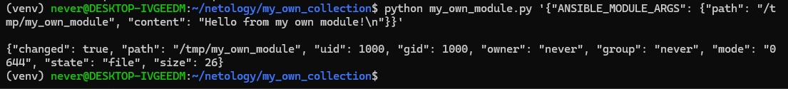
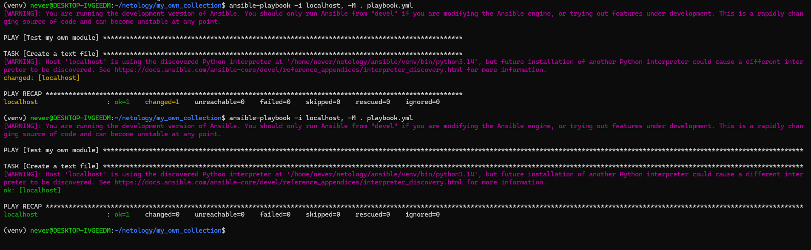
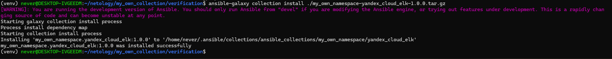
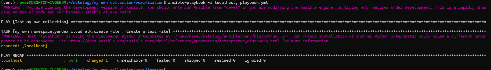

# Домашнее задание «Создание собственных модулей»

Написал модуль `my_own_module`, который создаёт текстовый файл. Путь к файлу задаётся параметром `path`, а содержимое — параметром `content`. Если файл уже содержит нужный текст, модуль возвращает `changed=false` и ничего не перезаписывает.

## Локальная проверка

Запустил модуль напрямую через Python. Он создал файл `/tmp/my_own_module` и вернул `changed=true`.

Затем создал playbook с одной задачей и выполнил его дважды. При первом запуске содержимое файла изменилось, при повторном изменений не было: `changed=0`. Оба запуска завершились без ошибок.

## Collection

Создал collection `my_own_namespace.yandex_cloud_elk` версии `1.0.0`. Модуль перенёс в `plugins/modules`. Задачу из playbook вынес в роль `create_file`.

В роли одна задача, которая вызывает модуль. Оба параметра вынесены в defaults:

| Переменная роли | Значение по умолчанию | Параметр модуля |
| --- | --- | --- |
| `my_own_module_path` | `/tmp/my_own_module` | `path` |
| `my_own_module_content` | `Hello from my own collection!` с переводом строки | `content` |

В `playbook.yml` используется роль из collection. В `examples/single_task.yml` сохранён вариант с прямым вызовом модуля. Модуль также поддерживает режимы check и diff. Родительский каталог файла должен существовать.

## Установка из архива

Собрал collection в архив и перенёс его вместе с playbook в отдельный каталог `verification`. Установил collection из локального архива. Версия `1.0.0` установилась успешно.

После установки запустил playbook из этого каталога. Он вызвал роль `my_own_namespace.yandex_cloud_elk.create_file`, которая записала текст в файл. Выполнилась одна задача, результат — `changed=1`, `failed=0`.

Собранный архив: [my_own_namespace-yandex_cloud_elk-1.0.0.tar.gz](my_own_namespace-yandex_cloud_elk-1.0.0.tar.gz).

[Репозиторий collection](https://github.com/nevers0nn/my_own_collection)
